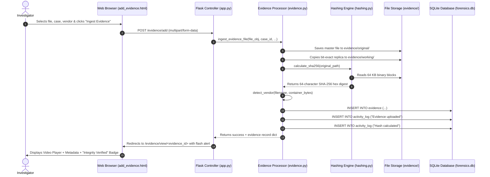

# Multi-Vendor DVR/NVR Forensic Analysis Tool: Internal Project Guide

Welcome to the internal technical documentation for the **Multi-Vendor DVR/NVR Forensic Analysis Tool for CCTV Evidence**. This guide explains every file, module, function, and database query in simple English so that any B.Tech CSE student can confidently explain the project during academic reviews and viva examinations.

---

## 1. Project Directory & File Explanation

The project is structured into 5 core Python files, clean HTML templates, static assets, and testing scripts.

```text
multi_vendor_dvr_forensics/
│
├── app.py                      # Core Flask controller and HTTP request routing
├── database.py                 # SQLite database schema, connections, and CRUD functions
├── hashing.py                  # Cryptographic SHA-256 calculation & integrity verification
├── evidence.py                 # Evidence intake, dual storage, and rule-based vendor detector
├── report.py                   # PDF forensic report generation using ReportLab
├── requirements.txt            # Minimal dependencies: Flask, ReportLab
├── forensics.db                # SQLite database file storing persistent records
│
├── templates/                  # HTML5 templates rendered by Jinja2
│   ├── base.html               # Shared layout, header, footer, 6-item navigation
│   ├── login.html              # Investigator login & one-click demo login
│   ├── dashboard.html          # Main metrics (Cases, Evidence, Videos, Activities)
│   ├── cases.html              # Case registry and case creation form
│   ├── case_details.html       # Individual case view with associated evidence
│   ├── add_evidence.html       # Evidence upload form with vendor selection
│   ├── analysis.html           # Evidence analysis table with keyword search & filters
│   ├── video_viewer.html       # Video preview, SHA-256 cards, and tamper demo controls
│   ├── activity.html           # Immutable chain of custody activity log
│   └── reports.html            # Generated reports archive and new report generator
│
├── static/
│   ├── css/
│   │   └── style.css           # Clean, white-background academic styling
│   └── js/
│       └── main.js             # Copy SHA-256 to clipboard & confirmation dialogs
│
├── evidence/
│   ├── original/               # Master evidence files (write-protected, never modified)
│   ├── working/                # Working copies used for analysis and streaming
│   └── demo_staging/           # Pre-packaged sample CCTV files for quick evaluation
│
├── reports/                    # Generated PDF reports saved here
│
└── tests/
    └── test_forensics.py       # Automated unit test suite (12 test cases)
```

---

## 2. Core Modules & Key Functions

### Module 1: `app.py` (Flask Controller & Web Routing)
`app.py` is the application's central nervous system. It initializes the Flask app, manages session-based login, and defines the HTTP routes that connect user web browser clicks to backend Python logic.

- **`login_required(view)`**: A Python decorator that verifies whether `'user'` exists in Flask's encrypted `session`. If not, it redirects the user to `/login`.
- **`login()` & `logout()`**: Handles authentication. Includes an academic convenience feature: a "One-Click Demo Login as Investigator" button that automatically creates an authenticated session.
- **`dashboard()` (`/dashboard`)**: Queries `get_dashboard_stats()`, `get_all_cases()`, and `get_all_evidence()` to render the 4 summary metric cards and recent tables.
- **`cases()` (`/cases`) & `create_case_route()` (`/cases/create`)**: Displays all cases and accepts POST form submissions to register new cases.
- **`case_details(case_id)` (`/cases/<case_id>`)**: Displays all metadata and exhibits attached to a single case.
- **`add_evidence()` (`/evidence/add`)**: Receives the uploaded multipart video file, calls `evidence.ingest_evidence_file()`, and redirects to the analysis viewer upon success.
- **`analysis()` (`/analysis`)**: Queries evidence records with support for keyword search and filter query parameters (`case_id`, `vendor`, `status`).
- **`evidence_view(evidence_id)` (`/evidence/view/<evidence_id>`)**: Prepares the examination screen, checking if the container format is playable in-browser.
- **`stream_evidence(evidence_id)` (`/evidence/stream/<evidence_id>`)**: Streams the working video file using Flask's `send_file` with the appropriate MIME type (e.g. `video/mp4`).
- **`verify_integrity_route(evidence_id)` (`/evidence/verify/<evidence_id>`)**: Recalculates the working copy's SHA-256 live and updates the status to either `Integrity Verified` or `Integrity Mismatch`.
- **`simulate_tamper_route()` & `restore_working_copy_route()`**: Viva demonstration endpoints to show examiners what happens when bytes are modified and how pristine restoration works.
- **`reports()` (`/reports`) & `generate_report_route(case_id)`**: Compiles the official PDF report using `report.generate_case_pdf_report()` and lists available PDFs for download.

---

### Module 2: `database.py` (SQLite Database Layer)
`database.py` manages all interactions with the SQLite database file (`forensics.db`). It enforces referential integrity using foreign keys and provides clean helper functions.

- **`get_db_connection()`**:
  - Connects to `forensics.db`.
  - Configures `conn.row_factory = sqlite3.Row` so column values can be accessed by column name (e.g., `row['filename']`).
  - Executes `PRAGMA foreign_keys = ON;` to enforce foreign key constraints.
- **`init_db()`**: Creates the 4 core relational tables if they do not already exist:
  1. `users`: Stores investigator username, password hash, role, and created date.
  2. `cases`: Stores `case_id`, `case_name`, `description`, `investigator_name`, `status`, and `created_at`.
  3. `evidence`: Stores `evidence_id`, foreign key `case_id`, `filename`, file paths (`original_path`, `working_path`), `file_size`, `vendor`, `source`, `sha256_original`, `sha256_current`, and `integrity_status`.
  4. `activity_log`: Stores immutable audit records: `action`, `details`, `case_id`, `evidence_id`, `performed_by`, and `timestamp`.
- **`log_activity(action, details, case_id, evidence_id, performed_by)`**: Appends a timestamped audit trail entry into `activity_log`.
- **`get_dashboard_stats()`**: Computes the 4 dashboard numbers: Total Cases, Total Evidence Files, Videos Available, and Recent Activities count.
- **`create_case(...)`**: Validates uniqueness and inserts a new case record.
- **`get_all_evidence(case_id, search, vendor, status)`**: Dynamically builds SQL `SELECT` queries with parameterized filters (`?`) to prevent SQL injection.
- **`update_evidence_integrity(evidence_id, current_hash, integrity_status)`**: Updates the live SHA-256 hash and verification badge in the database.

---

### Module 3: `hashing.py` (Cryptographic Integrity Engine)
`hashing.py` provides deterministic, mathematical proof that evidence has not been tampered with.

- **`calculate_sha256(file_path)`**:
  - Opens the target file in binary read mode (`'rb'`).
  - Reads the file in **64 KB (65,536 bytes) chunks** inside a `while` loop until EOF.
  - Updates a `hashlib.sha256()` object with each chunk.
  - Returns the final 64-character hexadecimal digest string.
  - *Why chunked reading?* Reading in chunks ensures the application uses only 64 KB of RAM regardless of whether the CCTV video is 5 MB or 5 GB!
- **`verify_file_integrity(original_hash, file_path)`**:
  - Computes the live SHA-256 hash of the file currently sitting on disk.
  - Compares the freshly computed hash with `original_hash` (recorded at intake).
  - Returns `(True, current_hash, "Integrity Verified")` if identical.
  - Returns `(False, current_hash, "Integrity Mismatch")` if any single bit changed.
- **`simulate_tampering(working_path)`**:
  - Appends a 16-byte marker (`b"\xDE\xAD\xBE\xEF_TAMPERED"`) to the working copy only.
  - The pristine original file in `evidence/original/` is completely untouched.
  - Recomputes and returns the altered hash so the UI immediately shows "Integrity Mismatch".
- **`restore_working_copy(original_path, working_path)`**:
  - Copies the untouched original master file over the working duplicate via `shutil.copy2()`.
  - Recomputes the hash, restoring the status back to "Integrity Verified".

---

### Module 4: `evidence.py` (Storage & Vendor Identification)
`evidence.py` enforces forensic preservation standards and implements rule-based vendor detection.

- **`detect_vendor(filename, user_override, sample_bytes)`**:
  - **User Override:** If the investigator manually specified a known vendor, it is respected.
  - **Dahua Rule:** Checks for `.dav` extension, `DHAV` or `DAHUA` header magic bytes in the first 64 bytes, or names containing `dahua`, `dh_`, or `_main_`.
  - **Hikvision Rule:** Checks for names containing `hik_`, `hikvision`, or channel syntax like `ch01_`, `ch02_`, or `_h4_`.
  - **Honeywell Rule:** Checks for names containing `hw_`, `honeywell`, `cam0`, or `hn_`.
  - **Unknown/Other Fallback:** When no proprietary markers match, classifies as Unknown/Other.
- **`is_video_playable_in_browser(filename)`**:
  - Validates container extension. Modern browsers support MP4 (H.264), WebM, and Ogg.
  - Formats like `.dav` or `.avi` return `False` alongside an informative explanation: *Proprietary CCTV containers lack native browser decoders. In digital forensics, files are preserved in their original bitstream rather than transcoded.*
- **`ingest_evidence_file(file_storage, case_id, source, vendor_choice, notes, investigator_name)`**:
  - Secures the filename using `werkzeug.utils.secure_filename`.
  - Generates a unique exhibit identifier: `EVID-YYYYMMDD_HHMMSS`.
  - Saves the bit-exact uploaded file to `evidence/original/<EVID>_<filename>`.
  - Copies an exact duplicate to `evidence/working/<EVID>_<filename>`.
  - Computes the initial SHA-256 hash.
  - Runs rule-based vendor detection.
  - Writes the record into SQLite `evidence` table.
  - Logs two separate actions in `activity_log`: `"Evidence uploaded"` and `"Hash calculated"`.

---

### Module 5: `report.py` (Forensic PDF Generator)
`report.py` generates formal, court-admissible forensic examination reports in PDF format using the `reportlab` library.

- **`generate_case_pdf_report(case_id, generated_by)`**:
  - Fetches case information, attached evidence records, and chain of custody logs from SQLite.
  - Uses `SimpleDocTemplate` with standard letter pagesize and professional styling.
  - **Section 1: Case Summary:** Case ID, Case Name, Date Created, Lead Investigator, Description.
  - **Section 2: Evidence Inventory Table:** Exhibit ID, Filename, Vendor, Size, Integrity Status.
  - **Section 3: Cryptographic Hash Details:** Full original SHA-256, current SHA-256, verification badge, and investigator notes.
  - **Section 4: Chain of Custody History Table:** Timestamp, Action, Performed By, Details.
  - **Section 5: Forensic Integrity Principles & Limitations:** Statements on the non-destructive principle, SHA-256 reliability, and academic prototype scope.
  - Saves the compiled PDF into `reports/Forensic_Report_<case_id>_<timestamp>.pdf`.
  - Logs `"Report generated"` in the SQLite activity log.

---

## 3. How the Frontend Connects to Flask

```text
Browser HTML Form/Link ──(HTTP GET / POST)──> Flask Route (@app.route) ──> Python Logic ──> SQLite/File ──> Jinja2 Template (HTML Rendered)
```

1. **Jinja2 Templating:**
   Flask renders HTML files located in `templates/` using the Jinja2 engine via `render_template('page.html', key=value)`. In the template, Python variables are inserted with `{{ variable }}` and logic is written using `` or ``.
2. **URL Generation:**
   Links in templates do not use hardcoded paths; they use `{{ url_for('route_function_name') }}`, such as `{{ url_for('dashboard') }}` or `{{ url_for('evidence_view', evidence_id=ev.evidence_id) }}`.
3. **Form Submissions:**
   - Case creation uses `<form method="POST" action="{{ url_for('create_case_route') }}">`.
   - File upload uses `<form method="POST" action="{{ url_for('add_evidence') }}" enctype="multipart/form-data">` to send binary files.
   - Integrity verification uses `<form method="POST" action="{{ url_for('verify_integrity_route', evidence_id=...) }}">`.
4. **Flash Messages:**
   Backend messages (e.g. `flash("Case created successfully.", "success")`) are queued in the user's session and rendered at the top of the next page via `get_flashed_messages()`.

---

## 4. How Flask Connects to SQLite

1. **Connection on Demand:**
   Whenever a route needs database data, it calls `get_db_connection()` in `database.py`.
2. **Parameterized Queries (SQL Injection Prevention):**
   SQL statements always use `?` placeholders or named parameters (e.g., `:case_id`) rather than string concatenation:
   ```python
   cursor.execute("SELECT * FROM cases WHERE case_id = ?", (case_id,))
   ```
3. **Row Factory:**
   Setting `conn.row_factory = sqlite3.Row` allows columns to be accessed like Python dictionaries: `case['case_name']`.
4. **Transaction Commit & Close:**
   Write operations (`INSERT`, `UPDATE`) call `conn.commit()` to persist changes to disk, followed by `conn.close()`.

---

## 5. What Happens Step-by-Step When Evidence is Uploaded

Here is the exact lifecycle of an uploaded CCTV video:



---

## 6. How SHA-256 Works in this Project

1. **What is SHA-256?**
   Secure Hash Algorithm 256-bit is a cryptographic hash function that produces a unique, fixed-size 64-character hexadecimal string from any arbitrary file input.
2. **Avalanche Effect:**
   If a single bit inside an hour-long CCTV video is altered, deleted, or corrupted, the resulting SHA-256 hash changes completely and unpredictably.
3. **One-Way Function:**
   It is computationally impossible to reconstruct the video footage from its hash string.
4. **Collision Resistance:**
   It is practically impossible for two different video files to produce the identical SHA-256 hash.
5. **How it verifies integrity:**
   - At time of seizure/upload: $H_{original} = \text{SHA-256}(\text{Original Evidence})$
   - At time of court examination: $H_{current} = \text{SHA-256}(\text{Working Copy})$
   - If $H_{current} == H_{original}$, mathematical proof exists that the video has not suffered any modification.

---

## 7. How PDF Reports are Generated

1. The investigator selects a case and triggers `/reports/generate/<case_id>`.
2. `report.py` queries SQLite for all records tied to `case_id`:
   - Case metadata from `cases`.
   - All evidence items and their original and current hashes from `evidence`.
   - The audit log entries from `activity_log`.
3. ReportLab builds a `SimpleDocTemplate` with clean tables, custom headers, and styled paragraph cells.
4. The document is compiled to `reports/Forensic_Report_<case_id>_<timestamp>.pdf`.
5. An audit entry `"Report generated"` is appended to `activity_log`.
6. The user is redirected to `/reports`, where they can click **Download PDF** to inspect the file.

---

## 8. Complete Feature Execution Flows (Action to Result)

### Feature 1: Case Creation
- **USER ACTION:** Fills out Case ID (`CASE-2026-002`), Case Name, and Investigator Name on `/cases` and clicks "Create Case File".
- **HTML PAGE:** `cases.html` `<form method="POST" action="/cases/create">`.
- **FLASK ROUTE:** `@app.route('/cases/create', methods=['POST'])` in `app.py`.
- **PYTHON FUNCTION:** `database.create_case(...)` executes `INSERT INTO cases`.
- **SQLITE / FILE:** Writes new row to `cases` table; logs `"Case created"` in `activity_log`.
- **RESULT:** User is redirected to `/cases/CASE-2026-002` with a green alert confirming case initialization.

### Feature 2: Evidence Upload & Ingestion
- **USER ACTION:** Selects a CCTV video file (e.g. `hik_ch01_test.mp4`), chooses a case, and clicks "Ingest Evidence".
- **HTML PAGE:** `add_evidence.html` `<form enctype="multipart/form-data">`.
- **FLASK ROUTE:** `@app.route('/evidence/add', methods=['POST'])`.
- **PYTHON FUNCTION:** `evidence.ingest_evidence_file()`.
- **SQLITE / FILE:** Original file saved to `evidence/original/`; working copy copied to `evidence/working/`; SHA-256 calculated; vendor detected; inserted into `evidence` and `activity_log` tables.
- **RESULT:** User redirected to `/evidence/view/<evidence_id>` displaying video preview, metadata, and "Integrity Verified".

### Feature 3: Evidence Search & Filter
- **USER ACTION:** Types keyword in search box or selects "Hikvision" from vendor filter on `/analysis` and clicks "Filter".
- **HTML PAGE:** `analysis.html` `<form method="GET" action="/analysis">`.
- **FLASK ROUTE:** `@app.route('/analysis')` reads `request.args.get('search')` and `request.args.get('vendor')`.
- **PYTHON FUNCTION:** `database.get_all_evidence(search=..., vendor=...)`.
- **SQLITE / FILE:** Executes parameterized SQL `SELECT * FROM evidence WHERE vendor = ? AND (filename LIKE ? ...)`.
- **RESULT:** Table reloads showing only matching exhibits with their live hashes and badges.

### Feature 4: Video Examination & Playback
- **USER ACTION:** Clicks "Examine Video" on an evidence item in the analysis table.
- **HTML PAGE:** `analysis.html` links to `/evidence/view/<evidence_id>`.
- **FLASK ROUTE:** `@app.route('/evidence/view/<evidence_id>')`.
- **PYTHON FUNCTION:** `evidence.is_video_playable_in_browser()`, `database.get_evidence_by_id()`.
- **SQLITE / FILE:** Logs `"Evidence analyzed"` in `activity_log`. If MP4, HTML5 `<video>` requests `/evidence/stream/<evidence_id>` which calls `send_file(working_path)`. If DAV/AVI, displays forensic explanation.
- **RESULT:** User watches video playback with play/pause/seek controls and sees file metadata alongside SHA-256 hashes.

### Feature 5: On-Demand Integrity Verification
- **USER ACTION:** Clicks "Verify Integrity Now" button on the video examination screen.
- **HTML PAGE:** `video_viewer.html` `<form method="POST" action="/evidence/verify/<evidence_id>">`.
- **FLASK ROUTE:** `@app.route('/evidence/verify/<evidence_id>', methods=['POST'])`.
- **PYTHON FUNCTION:** `hashing.verify_file_integrity(original_hash, working_path)`.
- **SQLITE / FILE:** Reads working copy, computes SHA-256, compares with original hash, updates `integrity_status` column in `evidence` table, and logs `"Hash calculated"` in `activity_log`.
- **RESULT:** Page reloads displaying green "Integrity Verified" alert badge.

### Feature 6: Viva Tamper Demonstration
- **USER ACTION:** Clicks "Simulate Tampering" button.
- **HTML PAGE:** `video_viewer.html` `<form method="POST" action="/evidence/tamper/<evidence_id>">`.
- **FLASK ROUTE:** `@app.route('/evidence/tamper/<evidence_id>', methods=['POST'])`.
- **PYTHON FUNCTION:** `hashing.simulate_tampering(working_path)`.
- **SQLITE / FILE:** Modifies 4 bytes on working copy; recomputes SHA-256; updates database status to `Integrity Mismatch`; logs action in `activity_log`. Original file remains completely safe.
- **RESULT:** Page reloads showing red alert badge: **`Integrity Mismatch`**.

### Feature 7: Working Copy Restoration
- **USER ACTION:** Clicks "Restore Working Copy from Pristine Original".
- **HTML PAGE:** `video_viewer.html` `<form method="POST" action="/evidence/restore/<evidence_id>">`.
- **FLASK ROUTE:** `@app.route('/evidence/restore/<evidence_id>', methods=['POST'])`.
- **PYTHON FUNCTION:** `hashing.restore_working_copy(original_path, working_path)`.
- **SQLITE / FILE:** Replaces working copy with pristine original; recomputes SHA-256; resets database status to `Integrity Verified`.
- **RESULT:** Page reloads displaying green "Integrity Verified" badge.

### Feature 8: PDF Forensic Report Generation
- **USER ACTION:** Chooses a case in `/reports` and clicks "Generate PDF Report".
- **HTML PAGE:** `reports.html` triggers `/reports/generate/<case_id>`.
- **FLASK ROUTE:** `@app.route('/reports/generate/<case_id>')`.
- **PYTHON FUNCTION:** `report.generate_case_pdf_report(case_id)`.
- **SQLITE / FILE:** Queries case, evidence, and activity tables; writes styled PDF to `reports/`; logs `"Report generated"` in `activity_log`.
- **RESULT:** User redirected to `/reports` with a download link for the newly created PDF report.
